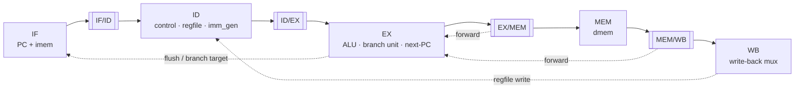

# RV32I In-Order Pipelined Processor

A RISC-V **RV32I** CPU written in SystemVerilog, developed with a verification-first methodology. The design started as a single-cycle core (v1.0) and is now a classic **5-stage in-order pipeline** (v2.0) with full forwarding, load-use stalling, and branch flushing. Each RTL module is paired with a self-checking testbench, and the full core is verified with a UVM environment against an ISA reference model.

## Highlights

- Full RV32I base integer ISA (except `FENCE`, `ECALL`, `EBREAK`)
- 5-stage pipeline: IF / ID / EX / MEM / WB
- EX/MEM and MEM/WB forwarding, plus write-back-to-decode register file bypass
- 1-cycle load-use stall; 2-cycle flush on taken branches and jumps (untaken branches are free)
- UVM testbench with a scoreboard that checks every register write against an ISA reference model
- Sky130 synthesis + static timing flow (Yosys + OpenSTA)

## Architecture



### Hazard handling

| Hazard | Detection | Resolution | Penalty |
|---|---|---|---|
| RAW on ALU result | `rd` in EX/MEM or MEM/WB matches `rs1`/`rs2` in EX | Forward to EX operands; EX/MEM has priority | 0 cycles |
| Load-use | Load in EX and its `rd` matches `rs1`/`rs2` in ID | Hold PC and IF/ID, insert NOP in ID/EX, then forward from MEM/WB | 1 cycle |
| WB → ID | Write-back and register read in the same cycle | Register file bypasses the write data to the read port | 0 cycles |
| Taken branch / JAL / JALR | Resolved in EX | Redirect PC, clear IF/ID and ID/EX | 2 cycles |

Stores forward their `rs2` data the same way, so a store can use a value produced by the instruction immediately before it.

### Write-back sources

| `wb_sel` | Source | Used by |
|---|---|---|
| `00` | ALU result | R-type, I-type ALU, AUIPC |
| `01` | dmem read data | LB, LH, LW, LBU, LHU |
| `10` | PC + 4 | JAL, JALR |
| `11` | Immediate | LUI |

## Supported Instructions

| Type | Instructions |
|---|---|
| R-type | `ADD` `SUB` `SLL` `SLT` `SLTU` `XOR` `SRL` `SRA` `OR` `AND` |
| I-type ALU | `ADDI` `SLTI` `SLTIU` `XORI` `ORI` `ANDI` `SLLI` `SRLI` `SRAI` |
| Load | `LB` `LH` `LW` `LBU` `LHU` |
| Store | `SB` `SH` `SW` |
| Branch | `BEQ` `BNE` `BLT` `BGE` `BLTU` `BGEU` |
| Jump | `JAL` `JALR` |
| Upper immediate | `LUI` `AUIPC` |

Not implemented: `FENCE`, `ECALL`, `EBREAK`, CSRs, and interrupts/exceptions.

## Repository Layout

```
rtl/            Synthesizable RTL
  cpu.sv          Top level: pipeline registers, forwarding, hazard logic
  control.sv      Opcode/funct decoder
  regfile.sv      32×32 register file with WB→ID bypass
  alu.sv          ALU
  imm_gen.sv      Immediate generator
  branch_unit.sv  Branch condition evaluation
  imem.sv         Instruction memory (loaded from hex file)
  dmem.sv         Data memory with byte/halfword access
tb/             Self-checking module-level testbenches
uvm/            UVM verification environment for the full core
synth/          Sky130 synthesis (Yosys) + STA (OpenSTA) flow
sim/            Test programs (.hex) and simulation outputs
```

## Getting Started

### Tools

| Purpose | Tool |
|---|---|
| Module testbenches | Icarus Verilog (`iverilog`, `vvp`) with `-g2012` |
| UVM simulation | Siemens Questa (tested with Questa FSE / Altera Starter, UVM 1.2) |
| Synthesis | `sv2v`, Yosys, Sky130 standard-cell Liberty file |
| Timing | OpenSTA |
| Waveforms | GTKWave |

### Module testbenches

Run from the repository root:

```bash
iverilog -g2012 -o sim/tb_alu.vvp tb/tb_alu.sv rtl/alu.sv
vvp sim/tb_alu.vvp

# Full CPU running sim/program.hex
iverilog -g2012 -o sim/tb_cpu.vvp tb/tb_cpu.sv rtl/*.sv
vvp sim/tb_cpu.vvp
gtkwave sim/tb_cpu.vcd
```

### UVM

```bash
cd uvm
make questa                       # default: cpu_smoke_test
make questa TEST=cpu_hazard_test
```

Set `QUESTA_HOME` if Questa is not installed at the default path in the Makefile.

### Synthesis and timing

```bash
export SKY130_LIB=/path/to/sky130_fd_sc_hd__tt_025C_1v80.lib
cd synth
make all        # sv2v → Yosys → OpenSTA
```

Reports are written to `synth/build/yosys.log` (area) and `synth/build/sta.log` (timing).

## Verification

### Module-level testbenches (`tb/`)

| Testbench | Approach |
|---|---|
| `tb_alu.sv` | Directed corner cases, then constrained-random with a self-checking scoreboard |
| `tb_imm_gen.sv` | Immediate decoding for every instruction format |
| `tb_regfile.sv` | Directed and random read/write tests against a reference register array |
| `tb_cpu.sv` | Runs a program from `sim/program.hex` on the full core |

### UVM environment (`uvm/`)

```
cpu_base_test
└── cpu_env
    ├── cpu_agent
    │   ├── sequencer
    │   ├── cpu_driver     loads the program into imem, controls reset
    │   └── cpu_monitor    reports every register write
    ├── cpu_scoreboard     compares each write with rv32i_ref_model
    └── cpu_coverage       functional coverage
```

The scoreboard runs an ISA reference model alongside the DUT. Each time the monitor sees a register write, the model advances to its next write and the two are compared. Because the core is in order, the two sequences stay aligned through stalls and flushes, so no cycle-accurate model is needed.

| Test | What it checks |
|---|---|
| `cpu_smoke_test` | Basic ALU instructions (`5 + 3 = 8`) |
| `cpu_hazard_test` | Smoke + load-use stall + EX/MEM and MEM/WB forwarding |

> **Note:** Questa FSE does not include the `svverification` license required for covergroups, so simulations that include `cpu_coverage` fail to load on FSE. A full Questa license is needed for coverage.

## Synthesis Results

Register file (`regfile.sv`) synthesized to Sky130 standard cells:

| Metric | Result |
|---|---|
| Target clock | 5.0 ns (200 MHz) |
| Worst setup slack | +0.63 ns (met) |
| Cell area | 50,385 µm² |

Synthesis of the full core is planned.

## Roadmap

### v1.0 — Single-cycle complete

- [x] Basic single-cycle architecture
- [x] Testbench development
- [ ] Test and profiling

### v2.0 — Classic 5-stage pipeline

- [x] Stage split: IF / ID / EX / MEM / WB with pipeline registers
- [x] Hazard detection unit
- [x] Forwarding / bypass network
- [x] UVM verification environment
- [ ] Re-run `riscv-tests` end-to-end
- [ ] Full-core synthesis and timing

## References

- *The RISC-V Instruction Set Manual, Volume I: Unprivileged ISA*
- D. Patterson and J. Hennessy, *Computer Organization and Design: RISC-V Edition*

**Author:** [@Leeboy0](https://github.com/Leeboy0)
